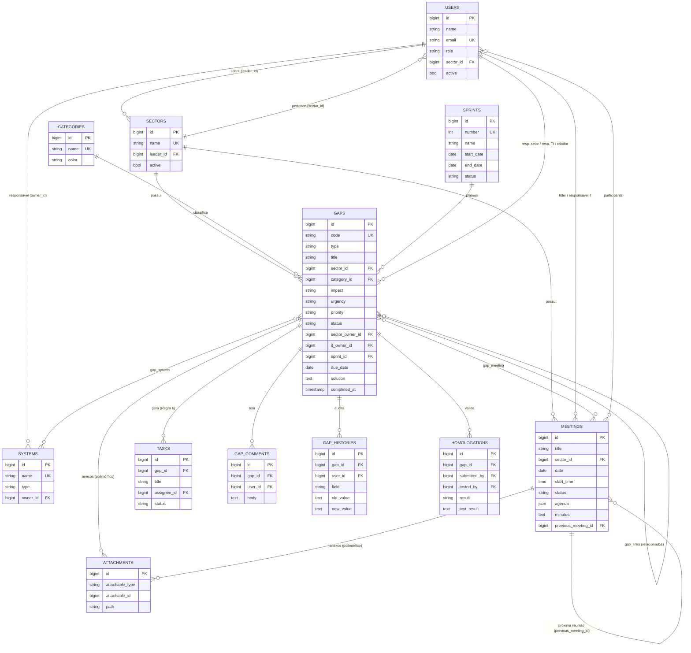
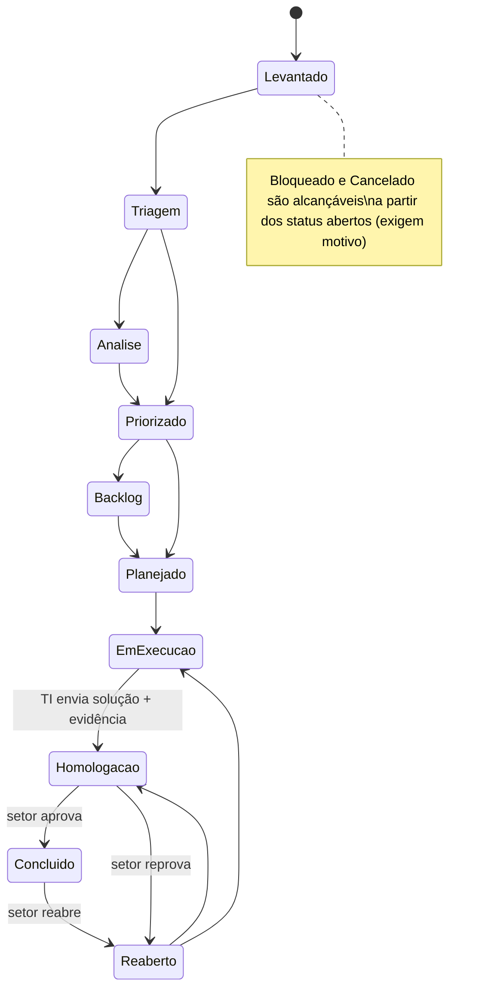

# Arquitetura — Central de Gestão de Gaps e Melhorias de TI

Este documento cobre os itens 1 a 7 da entrega: análise, arquitetura, banco de dados, ERD, endpoints, estrutura de pastas e plano por etapas. Ele também explica **por que** cada decisão foi tomada.

---

## 1. Análise da especificação

O núcleo do sistema é o **GAP**. Tudo gira em torno dele:

```
Reunião com o setor ──gera──▶ GAP ──quebra em──▶ Tarefas
                               │
                               ├─ classificação (impacto × urgência → prioridade)
                               ├─ responsáveis (setor + TI)
                               ├─ Sprint (Scrum)
                               ├─ workflow de status (máquina de estados)
                               ├─ homologação pelo setor
                               └─ comentários + histórico (auditoria)
```

Pontos de atenção identificados na especificação, e como foram resolvidos:

| Ponto | Decisão |
|---|---|
| GAP e Incidente têm fluxos diferentes (Scrum × Kanban) | Mesma tabela `gaps` com coluna `type`; cada tipo tem seu Enum de status e sua máquina de estados. Assim a conversão "incidente → GAP" é só uma mudança de tipo, e o histórico continua no mesmo registro. |
| "Todo GAP deve possuir um responsável" (Regra 2), mas o líder registra sem saber quem do TI vai atender | O responsável do setor é obrigatório desde o cadastro (o padrão é o líder do setor). O responsável TI passa a ser obrigatório a partir de **Priorizado**. |
| Kanban com colunas diferentes dos status | Cada coluna agrupa um ou mais status e define o status de destino do *drop* (`KanbanColumn::targetStatus()`). A coluna "Concluído" não aceita *drop*, porque só a homologação conclui um GAP (Regra 1). |
| Prioridade × Impacto × Urgência | A prioridade é **sugerida** por uma matriz (peso do impacto + peso da urgência) e pode ser ajustada manualmente pelo TI. |
| Auditoria de "toda alteração importante" | Um *Observer* do Eloquent grava o histórico automaticamente em qualquer `save()`, venha a alteração da tela, do Kanban, da Sprint ou da homologação. |
| Perfis com visões diferentes | RBAC por perfil (Enum `Role` com lista de permissões) + *Policies* por registro (o líder só acessa o próprio setor). |

---

## 2. Arquitetura proposta

**SPA (React) + API REST (Laravel) + MySQL**, em camadas:

```
┌──────────────────────── Frontend (React + TS) ────────────────────────┐
│ Pages ─▶ Components ─▶ React Query (cache) ─▶ lib/api.ts (axios+token) │
└───────────────────────────────────┬────────────────────────────────────┘
                                    │ HTTP/JSON  (Authorization: Bearer)
┌───────────────────────────────────▼──────────── Backend (Laravel) ─────┐
│ routes/api.php                                                          │
│   └─ Middleware: auth:sanctum ─▶ permission:<perm> (RBAC)               │
│        └─ Controller (fino) ─▶ FormRequest (validação)                  │
│              │                └▶ Policy (autorização por registro)      │
│              └─▶ Service (regras de negócio)                            │
│                    └─▶ Model Eloquent ─▶ Observer (auditoria)           │
│              ◀── API Resource (formato do JSON de saída)                │
└───────────────────────────────────┬─────────────────────────────────────┘
                                    ▼
                               MySQL/MariaDB
```

### Responsabilidade de cada camada (backend)

| Camada | Pasta | Responsabilidade | Exemplo |
|---|---|---|---|
| Rotas | `routes/api.php` | Mapear URL → controller e aplicar middlewares | `POST gaps/{gap}/transition` |
| Middleware | `app/Http/Middleware` | Barrar perfis sem permissão | `permission:gaps.create` |
| Form Request | `app/Http/Requests` | Validar a entrada | `StoreGapRequest` |
| Policy | `app/Policies` | "Pode fazer isso **neste** registro?" | O líder só valida GAPs do seu setor |
| Controller | `app/Http/Controllers/Api` | Orquestrar: validar, autorizar, chamar o service, devolver o resource | `GapController` |
| Service | `app/Services` | **Regras de negócio** | `GapService::transition()` |
| Enum | `app/Enums` | Valores fixos, rótulos e máquinas de estado | `GapStatus::transitions()` |
| Model | `app/Models` | Tabela, relacionamentos e *scopes* de consulta | `Gap::scopeVisibleTo()` |
| Observer | `app/Observers` | Efeitos colaterais automáticos | `GapObserver` grava o histórico |
| Resource | `app/Http/Resources` | Contrato do JSON de saída | `GapResource` |

> **Por que Services e não regras no Controller?** A mesma regra ("não pode concluir sem homologação") é usada pela tela de detalhe, pelo Kanban e futuramente por importações ou comandos agendados. Centralizada no service, ela fica escrita e testada uma única vez.

### Segurança

- **Autenticação:** Laravel Sanctum com *personal access tokens* (expiração de 12h). O login tem *rate limit* de 10 tentativas por minuto.
- **Autorização em duas camadas:** RBAC (middleware) + Policies (registro). O frontend esconde botões, mas **a API valida tudo de novo**. O frontend nunca é a camada de segurança.
- **Escopo do líder:** `Gap::scopeVisibleTo($user)` e `Meeting::scopeVisibleTo($user)` são aplicados em listagens, dashboard, Kanban e busca.
- **Anexos:** ficam fora da pasta pública (`storage/app/private`), com tipos e tamanho validados, e o download passa pela API com checagem de permissão.
- **Validação:** whitelist de colunas ordenáveis, Form Requests, `$fillable` explícito e `Model::shouldBeStrict()` em desenvolvimento (detecta N+1 e atributos não permitidos).
- **CORS** restrito a `FRONTEND_URL`.

---

## 3. Estrutura do banco de dados

| Tabela | Descrição | Principais colunas |
|---|---|---|
| `users` | Usuários | `role` (admin/ti/lider/consulta), `sector_id`, `active` |
| `sectors` | Setores | `name`, `leader_id → users`, `active` |
| `systems` | Sistemas da empresa | `name`, `type`, `owner_id → users` |
| `categories` | Categorias de GAP (configuráveis) | `name`, `color` |
| `meetings` | Reuniões | `sector_id`, `leader_id`, `it_owner_id`, `date`, `start_time`, `end_time`, `status`, `agenda` (JSON, 8 tópicos), `minutes` (ata), `summary`, `decisions`, `next_steps`, `previous_meeting_id` |
| `meeting_participants` | N:N reunião × usuário | PK composta |
| `sprints` | Sprints | `number` (único), `name`, `goal`, `start_date`, `end_date`, `status` |
| `gaps` | GAPs e incidentes | `code` (único), `type`, `title`, `description`, `sector_id`, `process`, `category_id`, `origin`, `impact`, `urgency`, `priority`, `frequency`, `critical_justification`, `sector_owner_id`, `it_owner_id`, `identified_at`, `due_date`, `sprint_id`, `status`, `solution`, `solution_evidence`, `completed_at`, `completed_by`, `deleted_at` |
| `gap_system` | N:N GAP × sistema | — |
| `gap_meeting` | N:N GAP × reunião (Regras 7 e 8) | — |
| `gap_links` | GAPs relacionados (Regra 5) | `gap_id`, `related_gap_id` |
| `tasks` | Tarefas do GAP (Regra 6) | `gap_id`, `assignee_id`, `status`, `due_date` |
| `gap_comments` | Comentários (somente inserção) | `gap_id`, `user_id`, `body` |
| `gap_histories` | Auditoria | `gap_id`, `user_id`, `field`, `old_value`, `new_value`, `created_at` |
| `homologations` | Ciclos de homologação | `submitted_by/at`, `tested_by/at`, `result` (aprovado/reprovado/pendente = null), `test_result`, `notes` |
| `attachments` | Anexos polimórficos (GAP ou reunião) | `attachable_type`, `attachable_id`, `path`, `mime_type`, `size` |
| `personal_access_tokens` | Tokens do Sanctum | — |

Decisões de modelagem:

- **Enums como `string`** no banco (ex.: `status = 'em_execucao'`) em vez de `ENUM` do MySQL: adicionar um status novo não exige `ALTER TABLE`, e o valor continua legível em consultas SQL diretas.
- **Soft delete** em `gaps`: o código `GAP-0010` nunca é reutilizado, e o histórico e os relatórios continuam íntegros.
- **Índices** em `status`, `priority`, `impact`, `due_date`, `type` e no índice composto `(sector_id, status)`, que é o filtro mais comum do dashboard e do Kanban.
- **Homologação como tabela própria** (e não como colunas no GAP): um GAP pode ser reprovado e reenviado várias vezes, e cada ciclo fica registrado.
- **Histórico guarda texto legível** ("Média → Alta", "Sprint 3 - Cadastros"), e não IDs, para continuar compreensível mesmo que o cadastro mude depois.

---

## 4. ERD



---

## 5. Endpoints da API

Todos sob o prefixo `/api`. Exceto o login, todos exigem `Authorization: Bearer <token>`. Erros de validação e de regra de negócio retornam **422** com `{ message, errors? }`; falta de permissão retorna **403**.

### Autenticação e apoio

| Método | Rota | Permissão | Descrição |
|---|---|---|---|
| POST | `/auth/login` | pública | `{email, password}` → `{token, user{..., permissions}}` |
| GET | `/auth/me` | autenticado | Usuário logado e suas permissões |
| POST | `/auth/logout` | autenticado | Revoga o token atual |
| GET | `/lookups` | autenticado | Enums + setores, sistemas, categorias, sprints e usuários (para selects) |
| GET | `/search?q=` | autenticado | Busca global; um código exato retorna `redirect` |

### Cadastros (leitura: todos; escrita: admin)

| Método | Rota | Descrição |
|---|---|---|
| GET/POST | `/users` | Listar (paginado, `?q=&role=`) / criar |
| GET/PATCH/DELETE | `/users/{id}` | Detalhe / editar / **desativar** (usuários não são excluídos) |
| GET/POST | `/sectors`, `/systems`, `/categories` | Listar / criar |
| GET/PATCH/DELETE | `/sectors/{id}`, `/systems/{id}`, `/categories/{id}` | A exclusão é bloqueada se houver vínculos (o caminho é desativar) |

### Reuniões

| Método | Rota | Permissão | Descrição |
|---|---|---|---|
| GET | `/meetings?sector_id=&status=&from=&to=&q=` | meetings.view | Lista paginada (o calendário usa `from`/`to`) |
| GET | `/meetings/{id}` | meetings.view | Detalhe com pauta, ata, participantes, GAPs e anexos |
| POST | `/meetings` | meetings.manage | Criar (com `participant_ids`, `gap_ids`, `agenda{}`) |
| PATCH | `/meetings/{id}` | meetings.manage | Editar, reagendar, mudar status, registrar ata e vincular GAPs |
| DELETE | `/meetings/{id}` | admin | Excluir |
| POST | `/meetings/{id}/next` | meetings.manage | Criar a próxima reunião (copia setor, participantes e próximos passos) |
| POST | `/meetings/{id}/attachments` | meetings.manage | Anexar arquivo (`multipart`, campo `file`) |

### GAPs

| Método | Rota | Permissão | Descrição |
|---|---|---|---|
| GET | `/gaps` | gaps.view | Filtros: `type, sector_id, status, priority, impact, category_id, it_owner_id, sprint_id (ou none), system_id, open, overdue, q, sort, direction, page, per_page` |
| POST | `/gaps` | gaps.create | Criar (código e prioridade automáticos) |
| GET | `/gaps/{id}` | gaps.view + policy | Detalhe completo + `allowed_transitions` |
| PATCH | `/gaps/{id}` | gaps.update \| gaps.complement | Editar (cada perfil só altera os campos permitidos) |
| DELETE | `/gaps/{id}` | admin | Soft delete |
| POST | `/gaps/{id}/transition` | gaps.transition \| gaps.reopen | `{status, reason?}`: movimenta o workflow |
| POST | `/gaps/{id}/convert` | gaps.convert | Converte um incidente em GAP/Melhoria |
| GET | `/gaps/{id}/history` | gaps.view | Histórico de auditoria |
| GET/POST | `/gaps/{id}/comments` | gaps.view / comments.create | Comentários |
| GET/POST | `/gaps/{id}/tasks` | gaps.view / tasks.manage | Tarefas |
| PATCH/DELETE | `/tasks/{id}` | tasks.manage | Atualizar / remover tarefa |
| POST | `/gaps/{id}/links` | gaps.update | `{related_gap_id}`: vincula nos dois sentidos |
| DELETE | `/gaps/{id}/links/{related}` | gaps.update | Desvincula |
| POST | `/gaps/{id}/attachments` | attachments.create | Anexar evidência |
| GET | `/attachments/{id}/download` | gaps.view + policy | Download |
| DELETE | `/attachments/{id}` | autor ou admin | Remover anexo |

### Homologação, Kanban, Sprints e Dashboard

| Método | Rota | Permissão | Descrição |
|---|---|---|---|
| POST | `/gaps/{id}/homologation/send` | gaps.homologation.send | `{solution, solution_evidence}` → status Homologação |
| POST | `/gaps/{id}/homologation/decide` | gaps.homologation.decide + policy | `{approved, test_result, notes?}` → Concluído ou Reaberto |
| GET | `/kanban` | gaps.view | Colunas com os cards (aceita os mesmos filtros de `/gaps`) |
| POST | `/kanban/{gap}/move` | gaps.transition | `{column, reason?}` |
| GET | `/sprints` · `/sprints/{id}` | sprints.view | Lista com progresso / detalhe com os GAPs |
| POST/PATCH/DELETE | `/sprints` · `/sprints/{id}` | admin | Gerenciar sprints |
| POST | `/sprints/{id}/gaps` | sprints.assign | `{gap_ids: []}`: associa GAPs (com auditoria) |
| DELETE | `/sprints/{id}/gaps/{gap}` | sprints.assign | Remove o GAP da sprint |
| GET | `/dashboard` | dashboard.view \| dashboard.sector | Indicadores (para o líder, já filtrados pelo setor dele) |
| GET | `/dashboard/sectors/{id}` | dashboard.view \| dashboard.sector | Dashboard de um setor |

Lista sempre atualizada: `php artisan route:list --path=api`.

---

## 6. Estrutura de pastas

```
backend/
├── app/
│   ├── Enums/              Role, GapStatus, IncidentStatus, KanbanColumn, Impact, Urgency, Priority...
│   ├── Exceptions/         BusinessRuleException (regra de negócio violada → 422)
│   ├── Http/
│   │   ├── Controllers/Api/  um controller por recurso
│   │   ├── Middleware/       EnsurePermission (RBAC)
│   │   ├── Requests/         StoreGapRequest, UpdateGapRequest, MeetingRequest
│   │   └── Resources/        formato do JSON de saída
│   ├── Models/             Eloquent + relacionamentos + scopes
│   ├── Observers/          GapObserver (auditoria)
│   ├── Policies/           GapPolicy, MeetingPolicy
│   ├── Providers/          AppServiceProvider (morph map, modo estrito)
│   └── Services/           GapService, HomologationService, KanbanService, DashboardService
├── database/
│   ├── factories/          dados para os testes
│   ├── migrations/         estrutura do banco
│   └── seeders/            Catalog (produção) + Users/Sprints/Meetings/Gaps (fictícios)
├── lang/pt_BR/             mensagens de validação em português
├── routes/api.php
└── tests/
    ├── Unit/               regras puras (matriz de prioridade, máquina de estados)
    └── Feature/            API ponta a ponta (auth, permissões, workflow, homologação, kanban, dashboard)

frontend/src/  → ver frontend/README.md
```

---

## 7. Plano de desenvolvimento por etapas

| Etapa | Escopo | Situação |
|---|---|---|
| **1. Fundação** | Projetos Laravel e React, autenticação Sanctum, RBAC, layout | ✅ Entregue |
| **2. Cadastros** | Usuários, setores, sistemas, categorias | ✅ Entregue |
| **3. Reuniões** | Cadastro, pauta, ata, participantes, próxima reunião, calendário | ✅ Entregue |
| **4. GAPs** | Cadastro rápido, código, prioridade, workflow, responsáveis, comentários, histórico, tarefas, relacionados, anexos | ✅ Entregue |
| **5. Scrum/Kanban** | Sprints, associação ao backlog, quadro com drag and drop e filtros | ✅ Entregue |
| **6. Homologação** | Envio pelo TI, aprovação/reprovação pelo setor, reabertura | ✅ Entregue |
| **7. Indicadores** | Dashboard executivo e por setor | ✅ Entregue |
| **8. Notificações** | Tabela `notifications` do Laravel + e-mail; comando agendado (`schedule`) para "GAP próximo do vencimento/vencido" e "reunião próxima"; sino na barra superior | Próxima etapa |
| **9. Relatórios e exportação** | Relatórios por setor/período/sistema/responsável, produtividade do TI, pendências; exportação para Excel/CSV (`maatwebsite/excel` ou `openspout`) e PDF (`barryvdh/laravel-dompdf`) | Próxima etapa |
| **10. Agenda avançada** | Arrastar reuniões no calendário, conflitos de horário, convite `.ics`/Outlook | Futuro |
| **11. Integrações e automação** | SSO/AD (LDAP), abertura de GAP via Fluig, webhook de incidentes, SLA automático por prioridade | Futuro |

A estrutura já prevê essas etapas: os eventos de domínio (atribuição, bloqueio, homologação) estão concentrados nos Services e no Observer, que são os pontos naturais para disparar as notificações.

---

## Onde cada regra de negócio está implementada

| Regra | Implementação | Teste |
|---|---|---|
| 1. Só conclui com validação do setor | `GapService::transition()` bloqueia o status Concluído; apenas `HomologationService::decide()` conclui. O Kanban não aceita *drop* em "Concluído". | `test_cannot_conclude_without_homologation`, `test_cannot_drop_card_on_done_column` |
| 2. Todo GAP tem responsável | Padrão: o líder do setor. `GapService::assertRules()` exige o responsável TI a partir de Priorizado. | `test_it_owner_is_required_to_prioritize` |
| 3. GAP crítico exige justificativa | `StoreGapRequest` (`required_if`) + `GapService::assertRules()` | `test_critical_gap_requires_justification` |
| 4. Alteração de prioridade no histórico | `GapObserver::updated()` | `test_priority_change_is_recorded_in_history` |
| 5. GAPs relacionados | Tabela `gap_links`, vínculo bidirecional | `test_gaps_can_be_linked_both_ways` |
| 6. GAP gera várias tarefas | Tabela `tasks` | `test_gap_can_have_many_tasks` |
| 7 e 8. Reunião ↔ GAPs (N:N) | Tabela `gap_meeting` | `test_meeting_can_generate_many_gaps_and_schedule_next` |
| Só o setor solicitante homologa | `GapPolicy::decideHomologation()` | `test_leader_from_another_sector_cannot_decide`, `test_ti_cannot_approve_its_own_solution` |
| Líder vê só o seu setor | `scopeVisibleTo()` + Policies | `test_leader_only_sees_own_sector` |

### Workflow do GAP (máquina de estados — `app/Enums/GapStatus.php`)



---

## Decisões e alternativas (para estudo)

- **Token (Bearer) × cookie de sessão (Sanctum SPA):** usei token porque frontend e backend rodam em portas ou domínios diferentes e o modelo é mais simples de entender e de testar (Postman/Insomnia). Em produção, com os dois sob o mesmo domínio, a autenticação SPA por cookie `HttpOnly` é mais resistente a XSS. Vale migrar quando o sistema for publicado.
- **RBAC em Enum × tabelas `roles/permissions` (ex.: spatie/laravel-permission):** com 4 perfis fixos, o Enum é mais simples e fica versionado no Git. Se o administrador precisar criar perfis pela tela, migre para tabelas. Os controllers não mudam, porque só conhecem as strings de permissão.
- **React Query × Redux:** quase todo o estado do app vem do servidor. O React Query resolve cache, loading e invalidação com muito menos código.
- **Dashboard calculado on-the-fly:** consultas `GROUP BY` com índices atendem bem até dezenas de milhares de GAPs. Se crescer muito, faça cache (`Cache::remember` por alguns minutos) ou crie uma tabela de snapshots diários, que também habilita gráficos históricos mais ricos.
- **Geração de código `GAP-0001`:** `MAX + 1` dentro de uma transação, com `lockForUpdate` e coluna `UNIQUE` como garantia final. Uma alternativa mais robusta para alto volume é uma tabela de sequências por prefixo.
